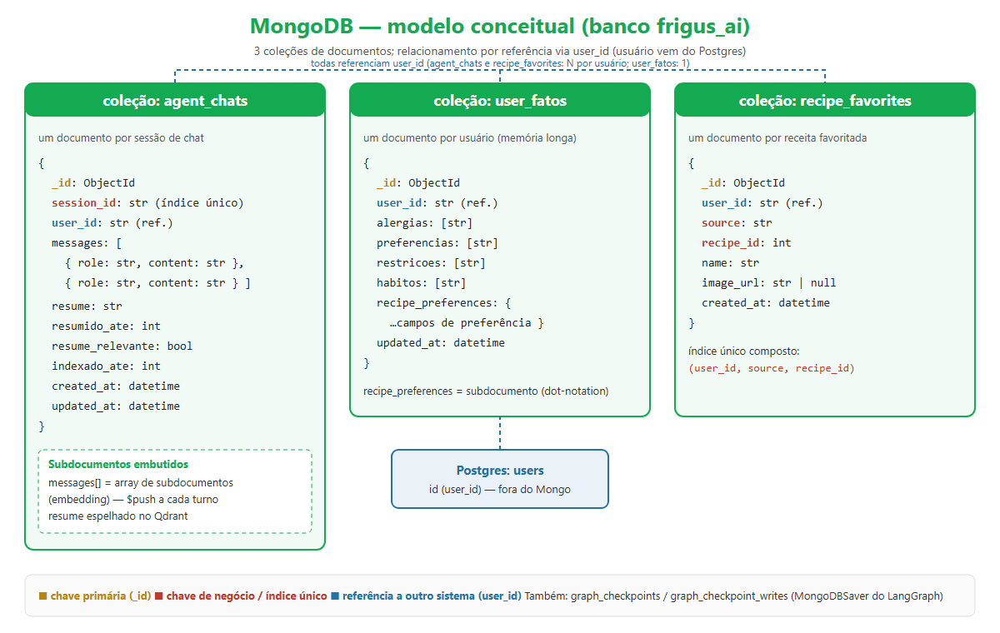
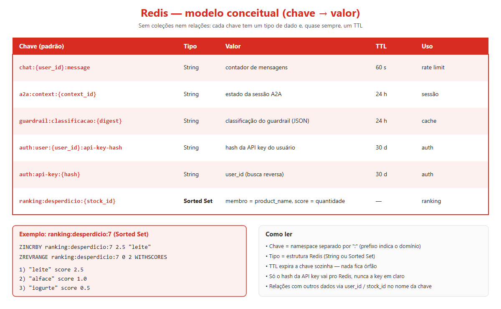
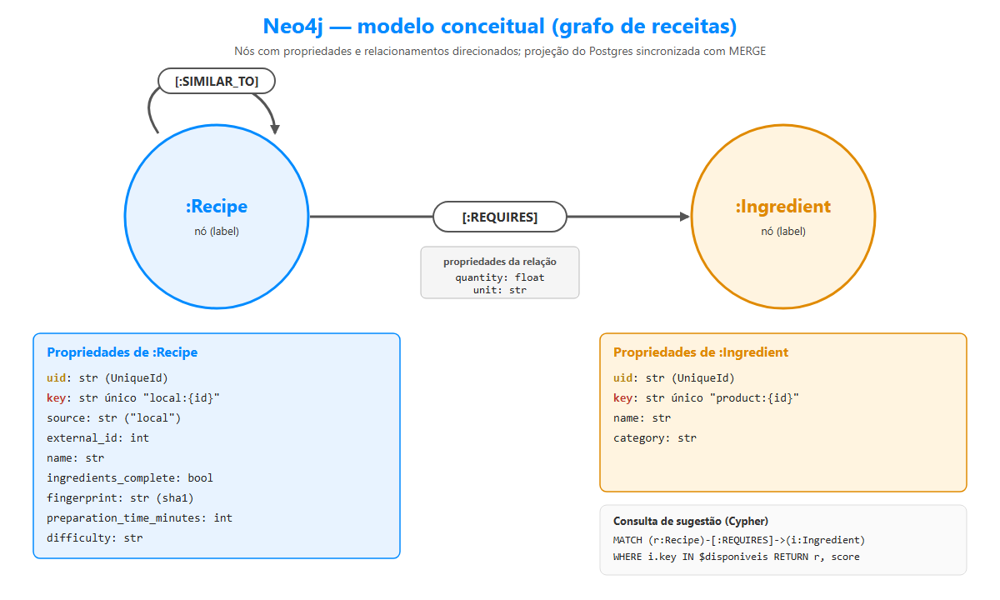

# databases-scripts

Scripts SQL (PostgreSQL) do banco de estoque/receitas/chat.

- `sql/schema/` — DDL (tabelas, enums, índices)
- `sql/functions/` — funções
- `sql/triggers/` — triggers
- `sql/procedures/` — procedures
- `sql/dataload/` — carga de dados
- `sql/queries/` — consultas avulsas
- `docs/` — documentação do banco e da modelagem
- `docs/nosql/` — modelos conceituais de MongoDB, Redis e Neo4j (com diagramas)

## Modelos NoSQL

Além do Postgres, o projeto usa MongoDB, Redis e Neo4j. Detalhes de campos, chaves e relações em
[docs/nosql/README.md](docs/nosql/README.md).

### MongoDB (documentos)

### Redis (chave-valor)

### Neo4j (grafo)

