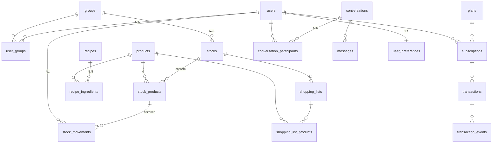

# Banco de dados do Frigus

PostgreSQL no Supabase. Este texto explica o que tem no banco e por quê. Números de linhas são de 02/11/2026.

## 1. Visão geral

O Frigus controla o estoque de alimentos de casas e empresas: o que tem na geladeira, quando vence, o que falta comprar, que receita dá para fazer, e conversas entre usuários do mesmo grupo.

O banco tem 5 schemas que importam:

| Schema | Para que serve |
|---|---|
| `public` | Dados do aplicativo (3FN). É o banco "de verdade" |
| `dw` | Data warehouse em estrela, para BI, mais o registro de acessos diários (DAU) |
| `analytics` | Views em estrela (dimensões e fatos) para ferramentas de BI |
| `audit` | Log de mudanças (quem mudou o quê) |
| `governance` | Catálogo de dados (descrição de tabelas e colunas) |

(`auth`, `storage`, `realtime` etc. são do próprio Supabase.)

## 2. Mapa do modelo (`public`)



### Por domínio

**Pessoas e grupos**
- `users` (3.347): quem usa o app. `account_type` = DOMESTIC, BUSINESS ou COMMERCIAL. Tem exclusão lógica (`deleted_at`).
- `groups` (1.231): "casa" ou empresa. Todo grupo tem um dono (`owner_id`).
- `user_groups` (3.793): quem participa de qual grupo e com qual papel (EDITOR ou VIEWER). Relação N:N.
- `user_preferences`, `user_app_settings`: configurações 1:1 com o usuário (a PK é o próprio `user_id`).
- `group_invitations`, `password_reset_tokens`, `support_requests`: convites, recuperação de senha e suporte.

**Estoque** (o centro do sistema)
- `stocks` (1.454): geladeira, freezer, despensa… de um grupo.
- `products` (258): catálogo de produtos (nome, marca, categoria, onde guardar, unidade, preço).
- `stock_products` (33.374): um produto dentro de um estoque, com quantidade, validade, lote e status (FRESH, NEAR_EXPIRATION, EXPIRED). Único por produto + estoque + validade.
- `stock_movements` (41.399): toda entrada (IN), saída (OUT) e ajuste (ADJUSTMENT).
- `discard` (3.821): descartes, com motivo.
- `product_categories` (22): árvore de categorias (ver seção 4).

**Compras**
- `shopping_lists` (2.177) e `shopping_list_products` (15.152): lista de compras de um estoque e seus itens (PENDING, PURCHASED, REMOVED).
- `business_expenses`, `food_purchases`, `food_purchase_lines`, `money_*`, `receipt_drafts`: despesas de empresa, notas fiscais lidas e controle financeiro.

**Receitas**
- `recipes` (340), `recipe_ingredients` (1.952): receitas e seus ingredientes (N:N com produtos).
- `recipe_suggestions` (2.472): receitas sugeridas para cada estoque, com nota (score) e a validade mais próxima.
- `recipe_favorites`: favoritas do usuário.

**Chat**
- `conversations` (1.513), `conversation_participants` (3.769), `messages` (19.672), `message_reads`, `message_attachments`, `message_reactions`. Conversa PRIVATE tem `pair_key` único (par de usuários); conversa GROUP aponta para um grupo.
- `requests` (1.600): pedidos feitos dentro de conversas.

**Assinaturas e pagamentos**
- `plans` (5), `subscriptions` (3.739), `transactions` (7.775), `transaction_events` (12.865): planos, assinatura do usuário, cobranças e o histórico de status de cada cobrança.

**Outros**
- `notifications` (1.339), `advertisements` (2), `flyway_schema_history` (versões das migrações, 003 a 019).
- `dm_*` (3 tabelas, vazias): resumos desnormalizados previstos, ainda sem carga.

## 3. Regras que o banco garante sozinho

- Quantidade nunca negativa; preço > 0; `member_role` só EDITOR/VIEWER; tipo de movimento só IN/OUT/ADJUSTMENT.
- Grupo ativo precisa de dono (`chk_active_groups_require_owner`).
- Conversa PRIVATE não tem grupo; conversa GROUP exige grupo.
- Um mesmo produto só aparece uma vez por estoque e validade.
- Status do item de estoque é calculado por trigger a partir da validade; `initial_quantity` é preenchida na entrada.
- `updated_at` é atualizado por trigger em todas as tabelas.
- Notificações: trigger avisa estoque baixo/zerado em conta comercial e item novo na lista de compras, respeitando as preferências do usuário.

## 4. Objetos programados

**Functions**
| Nome | O que faz |
|---|---|
| `fn_compute_product_status_enum(data, dias)` | Devolve FRESH, NEAR_EXPIRATION ou EXPIRED conforme a validade |
| `fn_low_stock_products(estoque)` | Lista itens abaixo do mínimo de um estoque |
| `fn_suggest_recipes(estoque)` | Para cada receita, quantos ingredientes tem, quantos faltam e uma nota de 0 a 1 |
| `fn_pair_key(uuid, uuid)` | Chave estável de um par de usuários (ordem não importa) |
| `dw.sp_load_all()` | Recarrega o DW inteiro (ver seção 5) |

**Procedures** (todas usam `uuid` para usuário, lista e conversa)
| Nome | O que faz |
|---|---|
| `sp_close_shopping_list(lista)` | Marca a lista como COMPLETED se todos os itens foram comprados ou removidos |
| `sp_purchase_shopping_list_item(lista, produto, estoque, qtd, validade, usuário, → stock_product_id)` | Marca o item como PURCHASED, cria o item de estoque se não existir, registra a entrada e soma a quantidade |
| `sp_get_or_create_private_conversation(a, b, → conversa)` | Acha ou cria a conversa privada entre dois usuários, sem duplicar |

**Estrutura recursiva.** `product_categories` tem `parent_id` apontando para ela mesma (Alimentos > Hortifruti > Frutas…). A view `analytics.vw_category_tree` usa `WITH RECURSIVE` para mostrar caminho, profundidade e o total de produtos de cada nó, somando os filhos.

## 5. BI: DW e analytics

**`dw` (estrela física).** Dimensões `dim_date`, `dim_group`, `dim_stock`, `dim_product`, `dim_user` e o fato `fact_stock_movement` (um registro por movimento de estoque). `dw.sp_load_all()` atualiza as dimensões e refaz o fato (TRUNCATE + INSERT). O RPA chama essa função no fim de cada ciclo (ver seção 7).

**`analytics` (estrela em views).** `dim_date`, `dim_plan`, `dim_product`, `dim_stock`, `fact_inventory_snapshot` e `fact_transactions` (traz receita acumulada com `SUM() OVER` e ranking do dia com `RANK()`), mais `vw_category_tree`.

**Views de resumo (`public`).** `vw_dm_stock_health` (saúde de cada estoque), `vw_dm_user_summary` (engajamento por usuário), `vw_dm_group_summary` (grupo), `vw_top_ingredients_analytics`, `vw_user_engagement_analytics`.

Técnicas usadas: CTEs em todas; window functions (`RANK`, `DENSE_RANK`, `ROW_NUMBER`, `LAG`, `FIRST_VALUE`, soma acumulada); `FILTER` em agregações.

## 6. Auditoria, DAU, governança

**Auditoria.** Triggers em `products` e `stock_products` chamam `audit.capture_row_change()`, que grava em `audit.row_change_log`: tabela, operação (`TG_OP`), usuário do banco (`CURRENT_USER`), linha antiga (`OLD`) e nova (`NEW`) em JSON, e a hora. Serve também para recuperar uma linha apagada ou alterada por engano.

**DAU (usuários ativos por dia).** `dw.user_daily_access` guarda um registro por usuário por dia (a PK composta impede repetir). O backend insere no primeiro acesso do dia, com `ON CONFLICT DO NOTHING`. `dw.vw_dau` calcula DAU, WAU (7 dias), MAU (30 dias) e a razão DAU/MAU.

**Catálogo de dados.** `governance.data_catalog` tem uma linha por coluna: tipo, descrição, regra de negócio, nível de acesso e classificação. Consulta de exemplo:
```sql
SELECT column_name, data_type, business_rules, access_level
FROM governance.data_catalog
WHERE object_schema = 'public' AND object_name = 'stock_products'
ORDER BY ordinal_position;
```

**Segurança.** RLS ligado nas tabelas principais de `public`; o backend conecta com papel de alto privilégio. Tabelas novas devem nascer com RLS e sem grants para `anon`/`authenticated`, como foi feito em `product_categories`.

## 7. RPA (do banco legado para o novo)

Python que copia o `dbFrigus` (somente leitura) para o Supabase, a cada hora ou sob demanda (`python main.py --once`, `--dry-run`).
- Cada ciclo é uma transação: se der erro, nada fica pela metade.
- Cada passo é idempotente (rodar de novo não duplica). Só insere; não atualiza nem apaga.
- Se a conexão cair, tenta 3 vezes com espera crescente. Valor desconhecido na origem (categoria, plano) para o ciclo com erro claro.
- Depois do commit, chama `dw.sp_load_all()` em transação separada; se o DW falhar, a migração continua gravada e o erro vai para o log. Mudança na branch `feat/recarga-dw-apos-ciclo` do repo `frigus-rpa`, ainda sem PR.
- Mapeamento tabela a tabela: `rpa/docs/tabelas.md`.

## 8. Desempenho

Há cerca de 100 índices: chaves estrangeiras, parciais (`WHERE deleted_at IS NULL`, `status = 'PENDING'`), compostos e um GIN para busca de texto em mensagens. Para analisar uma consulta lenta:
```sql
EXPLAIN (ANALYZE, BUFFERS) SELECT * FROM dw.vw_dau;
```
Em 02/11, `dw.vw_dau` rodou em ~2 ms com `Index Only Scan` em `ix_user_daily_access_date_user`, e a consulta da fato por data usou `ix_fact_mov_date`.

## 9. Backup e recuperação (rascunho a validar)

Confirmar no painel do Supabase o plano do projeto (retenção dos backups diários e PITR).
- **Backup:** diário automático do Supabase; `pg_dump --format=custom` semanal e antes de migrações, guardado fora do projeto com retenção de 4 semanas.
- **Falha de dado:** reconstruir a linha a partir de `audit.row_change_log.old_row` (para `products` e `stock_products`), ou restaurar para um ponto no tempo em projeto novo e copiar as linhas.
- **Perda total:** criar projeto novo, `pg_restore --no-owner`, rodar `SELECT dw.sp_load_all();`, conferir contagens (`users`, `stock_products`, `stock_movements`) e testar login e uma consulta de BI.
- **Teste de restauração:** fazer ao menos uma vez e anotar data, duração e resultado. Sugestão: RPO 24 h, RTO 4 h.

## 10. Pontos de atenção conhecidos

- O DW é refeito por inteiro a cada ciclo; com muito mais dados, vale torná-lo incremental.
- O DAU depende do backend inserir o acesso; não há trigger no banco para isso.
- Catálogo de dados com descrições genéricas e duas tabelas fora (`support_requests`, `user_app_settings`).
- 30 tabelas ainda sem RLS (entre elas `password_reset_tokens`, `notifications`, `dw.*`).
- `databases-scripts/sql/schema/schema.sql` está defasado em relação ao banco real (ids inteiros, enums em português).
