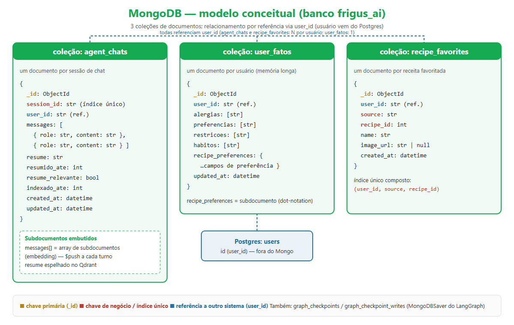
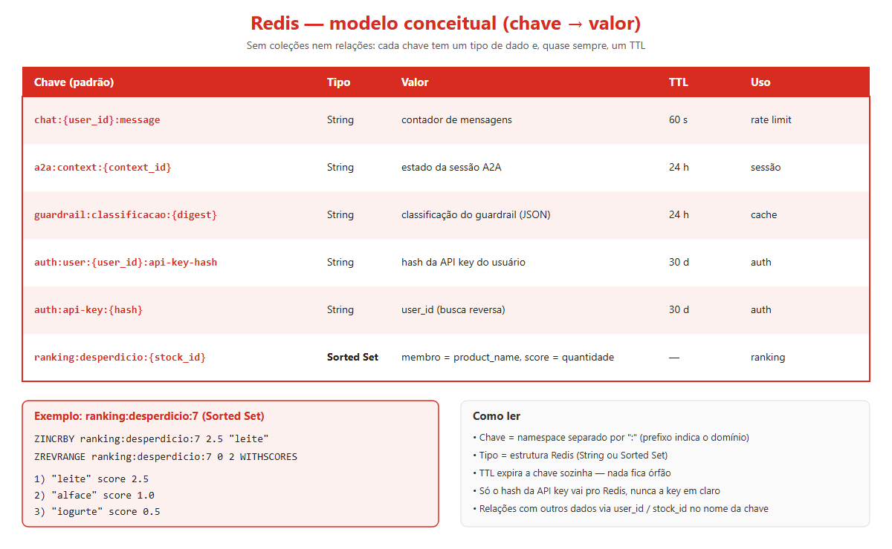
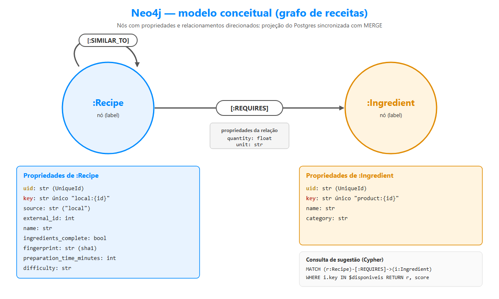

# Modelos conceituais dos bancos NoSQL

Além do Postgres (ver [../modelagem-de-dados.md](../modelagem-de-dados.md)), o Frigus AI usa três bancos
NoSQL, cada um com um paradigma diferente. Os diagramas abaixo foram feitos a partir do código do backend
(`frigus-ai`): repositórios em `repositories/`, chaves em `infra/redis/keys.py` e models em `infra/neo4j/models/`.

| Banco | Paradigma | Para que serve | Diagrama |
|---|---|---|---|
| MongoDB | Documentos | Histórico de chat, fatos/memória do usuário, receitas favoritas | [mongo.png](mongo.png) |
| Redis | Chave-valor | Rate limit, sessão A2A, cache do guardrail, API keys, ranking de desperdício | [redis.png](redis.png) |
| Neo4j | Grafo | Projeção das receitas e ingredientes para sugerir receitas compatíveis com o estoque | [neo4j.png](neo4j.png) |

Os arquivos `.svg` ao lado de cada PNG são a fonte editável.

---

## MongoDB (documentos)



Três coleções. O usuário vive no Postgres: os documentos o referenciam por `user_id` (referência, não
`$lookup` nem chave estrangeira).

### `agent_chats` — um documento por sessão de chat
| Campo | Tipo | Observação |
|---|---|---|
| `_id` | ObjectId | chave primária |
| `session_id` | str | índice único |
| `user_id` | str | dono da sessão |
| `messages` | array de `{role, content}` | subdocumentos embutidos; `$push` a cada turno |
| `resume` | str | resumo da conversa |
| `resumido_ate` | int | quantas mensagens o resumo já cobre |
| `resume_relevante` | bool | se o resumo vai para o Qdrant |
| `indexado_ate` | int | `resumido_ate` já indexado no Qdrant (menor = embedding pendente) |
| `created_at`, `updated_at` | datetime | |

Por que embutir `messages`: o histórico é sempre lido junto com a sessão e só cresce por append.

### `user_fatos` — um documento por usuário (memória de longo prazo)
| Campo | Tipo | Observação |
|---|---|---|
| `_id` | ObjectId | |
| `user_id` | str | |
| `alergias`, `preferencias`, `restricoes`, `habitos` | array de str | fatos extraídos da conversa |
| `recipe_preferences` | subdocumento | atualizado por campo (`recipe_preferences.<campo>`) |
| `updated_at` | datetime | |

### `recipe_favorites` — um documento por receita favoritada
| Campo | Tipo | Observação |
|---|---|---|
| `_id` | ObjectId | |
| `user_id`, `source`, `recipe_id` | str, str, int | índice único composto `(user_id, source, recipe_id)` |
| `name`, `image_url` | str, str ou null | retrato do card, evita nova chamada à Spoonacular |
| `created_at` | datetime | |

O LangGraph também grava as coleções `graph_checkpoints` e `graph_checkpoint_writes` (via `MongoDBSaver`,
com `thread_id = session_id`).

---

## Redis (chave-valor)



Não há coleções nem relações: o modelo é o padrão de chave. O prefixo indica o domínio.

| Chave | Tipo | Valor | TTL | Uso |
|---|---|---|---|---|
| `chat:{user_id}:message` | String | contador de mensagens | 60 s | rate limit |
| `a2a:context:{context_id}` | String | estado da sessão A2A | 24 h | sessão |
| `guardrail:classificacao:{digest}` | String | classificação do guardrail | 24 h | cache |
| `auth:user:{user_id}:api-key-hash` | String | hash da API key | 30 d | auth |
| `auth:api-key:{hash}` | String | `user_id` (busca reversa) | 30 d | auth |
| `ranking:desperdicio:{stock_id}` | Sorted Set | membro = nome do produto, score = quantidade | sem TTL | ranking |

- Só o hash da API key é guardado (HMAC-SHA256 quando há segredo configurado), nunca a key em claro.
- Ranking: `ZINCRBY` ao registrar desperdício, `ZREVRANGE ... WITHSCORES` para listar os maiores.
- Os tipos das chaves String foram inferidos do uso (`get`/`set`); só o Sorted Set é confirmado por comando
  específico.

---

## Neo4j (grafo)



O Postgres é a fonte; o grafo é uma projeção sincronizada no startup com `MERGE` (rodar de novo não duplica
nós nem relações). Só receitas novas ou alteradas são reenviadas, comparando `fingerprint`.

### Nós
**`:Recipe`**: `uid`, `key` (único, `local:<id>`), `source`, `external_id`, `name`, `ingredients_complete`,
`fingerprint`, `preparation_time_minutes`, `difficulty`.

**`:Ingredient`**: `uid`, `key` (único, `product:<id>`), `name`, `category`.

### Relacionamentos
- `(:Recipe)-[:REQUIRES {quantity, unit}]->(:Ingredient)`: ingredientes que a receita exige.
- `(:Recipe)-[:SIMILAR_TO]->(:Recipe)`: declarado no model, mas o sync atual não o preenche.

### Consulta de sugestão
```cypher
MATCH (r:Recipe {source: 'local'})-[:REQUIRES]->(i:Ingredient)
WHERE r.ingredients_complete = true
// filtra alergias, conta ingredientes disponíveis e prioriza os próximos do vencimento
RETURN r.external_id, r.name, score
```
Se o Neo4j estiver fora do ar, o backend cai no cruzamento SQL (`fn_suggest_recipes`).
