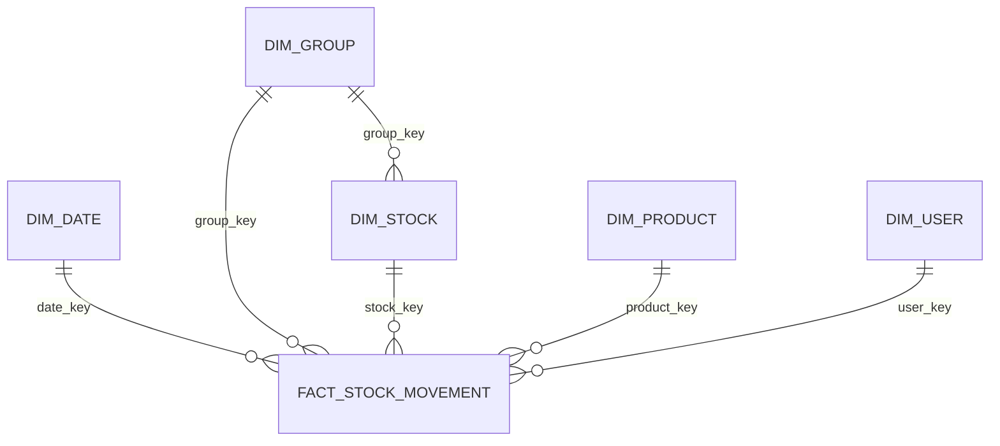

# Modelo relacional Frigus

## Evidencia do ambiente

FrigusDB Dev possui 43 PKs e 69 FKs em `public`, mais 6 PKs e 6 FKs em `dw`; existe tambem uma PK no schema `audit`. Total observado nos schemas `public`, `analytics`, `audit` e `dw`: 50 PKs e 75 FKs. O catalogo do PostgreSQL e o snapshot-base mais as migrations sao a fonte para os detalhes de constraint.

O modelo operacional separa entidades e associacoes. A avaliacao formal de 3FN deve ser feita sobre `public`; as dimensoes podem repetir atributos descritivos por decisao de modelagem dimensional.

## Cardinalidades principais

| Relacao | Cardinalidade | Chaves / observacao |
|---|---|---|
| `users` — titular de `groups` | 1:N | `groups.owner_id` FK para `users.id`; um grupo tem um titular. |
| `users` — `groups` | N:N | `user_groups(user_id, group_id)` associativa; unicidade impede participacao duplicada. |
| `groups` — `stocks` | 1:N | `stocks.group_id` FK. |
| `stocks` — `products` | N:N | `stock_products(stock_id, product_id)`; a associativa guarda lote, quantidade, validade e estado. |
| `stock_products` — `stock_movements` | 1:N | `stock_movements.stock_product_id` FK. |
| `users` — `stock_movements` | 1:N opcional | `stock_movements.user_id` FK nullable conforme movimento. |
| `recipes` — `products` | N:N | `recipe_ingredients(recipe_id, product_id)` associativa. |
| `users` — `recipes` favoritas | N:N | `recipe_favorites(user_id, recipe_id)` associativa. |
| `conversations` — `users` | N:N | `conversation_participants(conversation_id, user_id)` associativa. |
| `conversations` — `messages` | 1:N | Mensagem pertence a uma conversa. |
| `messages` — `message_attachments` | 1:N | Cada anexo aponta para a mensagem. |
| `dw.dim_group` — `dw.dim_stock` | 1:N | `dim_stock.group_key` referencia a dimensao de grupo. |
| cada dimensao (`date`, `group`, `stock`, `product`, `user`) — `dw.fact_stock_movement` | 1:N | A fato tem granularidade de uma linha por movimento (`movement_id`). |

As cardinalidades minima/maxima exatas devem considerar nulabilidade e constraints `UNIQUE`; relacoes opcionais estao identificadas acima.

## Diagrama dimensional

O arquivo `sql/schema/frigus_dev_base_schema.sql` registra o estado-base exportado do Dev antes das migrations desta entrega, sem dados de negocio.
